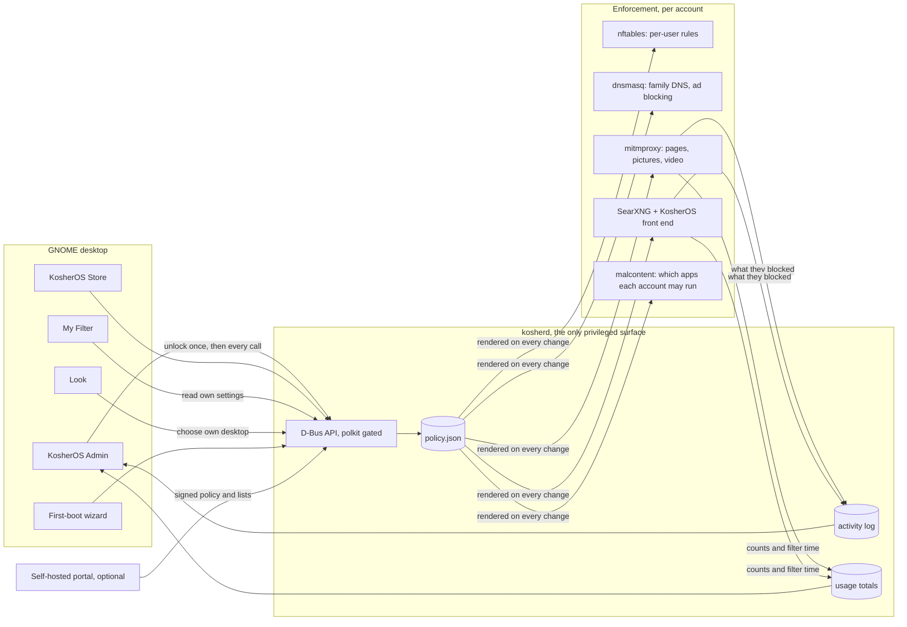

# Architecture

KosherOS is an immutable Fedora base, a GNOME desktop with three
per-account layouts, a content filter enforced per account at the network
layer, and administration without root. This page is the map; the pages
after it go into each part.

## Nobody has root

No `sudo` is shipped, the root account is locked, and a polkit rule removes
every polkit admin identity. That switches off every stock privileged
action: adding Flatpak remotes, rebasing the OS, changing the system
network. Stock update and package actions are denied quietly, with no
prompt, so desktop components do not pop a password dialog nothing could
satisfy.

The one privileged surface is **kosherd**, a root daemon with a D-Bus API.
Members of the `kosher-admin` group hold its `org.kosherlinux.*` polkit
actions from their own signed-in session, so an administrator is never
asked for a password to manage accounts, install apps, connect Wi-Fi or
apply updates. On any other account those actions ask for an
administrator's password once, through GNOME's own polkit agent, and the
daemon keeps a sliding session so nothing prompts again that sitting.

A short list of everyday settings is granted back to administrators without
a prompt, time zone, language, device name, joining a Wi-Fi network,
printers, colour profiles, so GNOME Settings works for a parent without
ever reaching services, packages or the image.

The daemon leans on the services that already exist, accountsservice,
Flatpak, bootc and NetworkManager, rather than reimplementing them.

**The guardian password.** Optionally, every call that weakens the filter
needs a second password on top, meant for the other spouse: changing an
account's mode, its sites, rules, categories, pictures, language, YouTube,
time limits or ports beyond the web; putting an account in a group or
changing the group; editing a list; approving a request; opening the store
or changing app blocks; the guest account; ad blocking; the update channel;
going back to the previous version; enrolling in or leaving a portal; making someone an administrator; and
turning the guardian off. It is stored as a yescrypt hash and rate limited, five tries
and then a fifteen-minute lockout.

## Two planes of enforcement

**DNS.** systemd-resolved is masked. dnsmasq is the only resolver, on
loopback, with its upstream fixed to a family-filtered service. nftables
redirects every human account's port-53 traffic to it, so picking another
resolver is impossible. Everyone gets family-filtered DNS and ad blocking
as a baseline; per-account differences happen at the packet layer. There
are three resolver instances. The family one answers filtered and
whitelist accounts, the proxy and the system. Basic protection
(`dnsfilter`) accounts get one of their own that adds the categories they
block, since nothing else can stop those for them. Unfiltered accounts get
a plain one. The ad list is rendered into all three. A category a filtered
account blocks is never blocked in DNS: the proxy needs the site's real
address to show the page that says why.

**Packets.** One nftables table, rendered from the policy and loaded
fail-closed before the network comes up. Every packet is dispatched by the
owning uid:

| Mode | In the admin app | Enforcement |
|---|---|---|
| `none` | No internet | loopback and LAN printing only; everything else refused |
| `whitelist` | Approved sites only | only addresses in the whitelist sets, which dnsmasq fills as it resolves approved names, so browsing by bare address is blocked for free |
| `dnsfilter` | Basic protection | 80, 443 and the named mail ports, only to addresses its own resolver handed out (so not by bare address) and never to the home network, behind family DNS, its category blocks and evasion blocking |
| `filtered` | Filtered internet | every TCP connection diverted into the account's own proxy listener |
| `unfiltered` | No filtering | open |

An account with no policy falls through to `none`. A shared chain refuses
DNS over TLS, QUIC and a set of DNS-over-HTTPS resolver addresses,
including the unfiltered public resolvers. The browsers are also told to
leave DNS over HTTPS off: Firefox by its policy file, and Chromium, Chrome,
Edge and Brave by a managed policy in the place each one's Flatpak reads.
Rootless containers do not
escape any of this: a user's network namespace reaches the host through an
ordinary process owned by that user, so the uid rules still match. A
captive-portal window, for hotel and airport Wi-Fi, is a set element with a
timeout.

## Filtered mode

At the DNS and packet layers a request is only ever "some host". The path
is encrypted, so `site.com/videos` cannot be told from `site.com/learn`.
Filtered mode terminates TLS locally so the full address and the page are
visible, and it is the only mode that can read a page, judge a picture, or
apply YouTube limits.

The daemon generates a certificate authority once, installs it in the
system trust store, and enables Firefox's enterprise-roots policy. The
cost, that this account's HTTPS is decrypted on this machine, is stated in
the admin app beside the mode. The proxy runs as its own unprivileged user,
one loopback listener per filtered account, and never reads the policy: the
daemon renders only what each account needs into a file the proxy can
read. [Content filtering](content-filtering.md) and [pictures and
video](media-filtering.md) describe what it does with what it sees.

## Apps

KosherOS hosts no package repository. Upstream Flathub is the source, and
only the daemon installs: polkit denies the Flatpak system-helper actions
to every non-root subject, and malcontent blocks user-scope installs. The
KosherOS Store is open to every account, supervised ones included, because
safety comes from the daemon's decision rather than from hiding the store.
The Store asks the daemon what this account may have, asks it to install,
and shows progress streamed back over D-Bus.

What an account may have is one rule, asked by the Store, by the installer
and by malcontent, so what cannot be installed cannot be run either:

1. **Blocks first.** Single apps and kinds of app a parent has blocked
   apply whatever else says. The kinds are the Store's own shelves,
   Internet, Work, Learning, Games, Music, Pictures & video, Developer
   tools, Utilities, folded from Flathub's categories.
2. **An approval settles it.** The approved list is what an administrator
   has said yes to by name.
3. **Approved only, or the whole store.** Every account starts with the
   approved list. A parent can open an account, or a group, to the whole
   store, and then:
4. **The content ceiling.** Flathub rates every app, and the daemon
   refuses anything above a fixed ceiling: nudity, sexual themes, bad
   language, gambling, drugs and graphic violence at none; cartoon and
   fantasy violence up to moderate; alcohol, tobacco and realistic
   violence up to mild. A short list of filter-circumvention tools, Tor
   launchers and VPN clients, is refused the same way. An app the index
   does not know is refused too, so being offline fails closed.

The app index is parsed once per catalogue download on a worker thread and
cached, so neither the Store nor a policy change waits on a forty-megabyte
parse. `kosherctl apps` shows and sets an account's access and blocks;
`kosherctl store` lists what is installed, what has an update, and updates
it, for a shell, a VM suite or a support call. For a person at a
terminal there is `kosher`, in the words apt and dnf taught: `kosher
install claude-code`, `kosher search`, `kosher list`, `kosher update`,
`kosher upgrade`, `kosher remove`, `kosher info`. It talks to the same
daemon under the same rules and shows the install as it happens.

A second source sits beside Flathub for what has no Flatpak, the AI coding
tools and a few editors and toolchains: upstream nixpkgs. A catalog entry
whose ref is `nixpkgs#<package>` is installed by the daemon into the asking
account's own Nix profile, as that account. The same rule decides it, and
because the profile is that account's alone there is no second gate to run
it. Each card in the Store says which source it is from. The Nix daemon
refuses an account on "No internet" outright, a build downloads only from
known source hosts (the forges, registries and mirrors nixpkgs fetches from,
plus any an administrator added; the builders' proxy refuses the rest), and
a terminal tool installed this way gets a launcher in the app grid that
opens a terminal running it.

A Nix app that draws with OpenGL or Vulkan brings its own graphics loader,
which looks for the drivers in `/run/opengl-driver`, as on NixOS. KosherOS
puts Mesa there: `kosher-nix-opengl.service` fetches a pinned Mesa from
NixOS's binary cache once, and a link in `/run` points at it. The pin is a
NixOS stable release, because a driver loads into the app's own process
and must not need a newer C library than the app has. The Store's apps
come from nixpkgs-unstable, which is always newer. Without this, Alacritty,
Ghostty, Cool Retro Term and kitty from nixpkgs cannot open a window, even
on a machine whose own drivers work. NVIDIA's proprietary driver is not
covered; KosherOS does not ship it. `scripts/nix-opengl-pin.sh` moves the
pin to a new NixOS release.

A third source is the developer's own signed build, for an app whose Nix
build cannot run here. A Nix build brings its own OpenGL library, which
finds no graphics driver on Fedora, so kitty from nixpkgs refuses to open
even when the drivers are fine. A catalog entry whose ref is
`upstream#kitty` is fetched from kitty's own releases as the asking
account, checked against the developer's signing key that the image
carries, and unpacked into that account's home with a launcher and its
commands in `~/.local/bin`. A download whose signature does not check out
is thrown away, and the copy already there stays. Installing it also
removes the account's old kitty from nixpkgs.

## The policy

One JSON document holds every account's settings and is the contract
between the daemon, the admin app and the portal. Its schema is in the
repository. A revision number and a source field are what make a second
writer safe.

## The portal

The portal is self-hostable and optional. It is a second writer of the
policy, so the device has to tell a genuine document from anything else,
and it does that with signatures rather than trust in the connection. The
portal generates an Ed25519 key on first start and signs every document; a
device pins the public half when it enrols with a one-time code, and
accepts a document only if the signature matches and the revision is
higher than the one it already applied, which is what stops an old,
looser policy being replayed at it. The device never signs and never holds
a private key, so a stolen device cannot forge policy for another one.

Sync is outbound only, every fifteen minutes, so no family machine opens
an inbound port. Enrolling and unenrolling take the guardian password.
Losing the portal does not unlock a device: the last applied policy keeps
being enforced.

## Tailscale

Tailscale is in the image, from Tailscale's own signed repository, and
`tailscaled` starts at boot. It does nothing until an administrator signs
the computer in from **Admin → Protection → Tailscale**. The daemon starts
the sign-in and the page shows the address to open, on this computer or a
phone. Signing in takes the guardian password, because it puts the
computer on a network with other machines that every account can then
reach. Signing out does not. `kosherctl tailscale` does the same from a
terminal.

No operator is set on `tailscaled`, so an account can read its status but
only root can change it, and root is kosherd. Every sign-in runs
`tailscale up` with the whole configuration and `--reset`, so nothing set
another way survives it:

| Flag | Why |
|---|---|
| `--accept-dns=false` | tailscaled never rewrites `/etc/resolv.conf`; dnsmasq stays the only resolver |
| `--shields-up` | no tailnet machine can open a connection to this one |
| `--ssh=false` | Tailscale's own SSH server stays off |
| `--netfilter-mode=off` | tailscaled adds no firewall rules of its own; its usual ones accept anything arriving on `tailscale0` |
| `--accept-routes=false` | other machines' subnets are not routed through here |

Serve and Funnel are never used, and the input chain drops what nobody
asked for, on `tailscale0` as anywhere else.

**Names.** dnsmasq forwards the signed-in tailnet's own domain, for
example `tail230de1.ts.net`, to tailscaled's resolver at 100.100.100.100,
in both the family resolver and the plain one. So `git.tail230de1.ts.net`
resolves for every account and every other name goes where it always did.
Only that one tailnet is forwarded, not all of `ts.net`: tailscaled hands
a name it does not own back to the system resolver, and that would be a
loop. The forward is written when the daemon sees the computer signed in
and removed when it signs out. `tailscale.com` is in the category list of
proxies and VPNs, which supervised accounts block by default, so it is
left out of the resolver's blocks. The resolver answers the machine's own
services too, and tailscaled cannot sign in without it. The proxy still
blocks the site itself for a filtered account.

**Filtering.** tailscaled runs as root, so its own traffic is let out like
every system service's. An account's traffic is matched by its owner in
the output hook, before it is routed, so a tailnet address is one more
destination behind the same rules. That would hold for an exit node too,
but none is set: the admin app does not offer one and every sign-in
clears it. A filtered account reaches it through its proxy listener, a
basic-protection account on the web and mail ports, an approved-sites
account only by an approved name, and an account with no internet not at
all.

## First boot

The installer creates no users and asks no passwords. On first boot a
kiosk session runs the setup wizard instead of the login screen, so the
machine cannot be used before it is configured. The wizard creates the
administrator, optionally sets the guardian password and a boot-menu
password, and shows the firmware checklist KosherOS cannot enforce itself:
a firmware password, USB and network boot off, Secure Boot kept on.
Finishing writes a stamp, disables the unit and starts the login screen.

The setup interface is the one path that runs without an authorised
administrator, because none exists yet, and it is bounded: creating the
first administrator is refused once any administrator is in the policy,
and every setup method is refused once the stamp exists. A wizard
interrupted after creating the administrator can still resume, because
completion is the stamp, not the existence of an administrator.

## Device security

Settings, Privacy & Security, Device Security reports the firmware's
security checks. Three of them are the operating system's to answer, and
the image sets all three on the kernel command line:

| Kernel argument | What it answers |
|---|---|
| `lockdown=integrity` | the kernel refuses the paths that would let root rewrite the running kernel. Secure Boot turns this on by itself; saying it explicitly gives a machine booted without Secure Boot the same floor |
| `intel_iommu=on` | devices sit behind the IOMMU. Modern kernels do this where the firmware allows; older Intel parts need asking, and it costs nothing where it is already on |
| `mem_sleep_default=s2idle` | suspend to idle rather than deep sleep, which leaves the memory image where firmware attacks can reach it |
| `rd.shell=0` | a failed early boot never offers a dracut shell — a root prompt before the filter is up, on a computer where nobody should have root |
| `rd.emergency=reboot` | and instead of waiting at that prompt, the computer restarts |

The boot menu itself has a password: the first-boot wizard sets one by
default, the administrator's own unless another is typed, and the text
setup does the same. Starting the computer never asks for it; editing an
entry or opening GRUB's command line does. A machine installed before this
was the default sets one from **Admin → Protection → Boot menu password**.

Text consoles are for administrators. Ctrl+Alt+F3 and a serial line still
show a login prompt, but only an account in KosherOS Admin's administrators
gets a shell there; anyone else is refused, so nobody steps outside the
desktop's app list, lock screen and time warnings. An administrator can
still sign in on one when the desktop will not start.

Nothing in the image loads an out-of-tree kernel module, so lockdown costs
the family nothing.

The rest of that panel is not the operating system's. Secure Boot, the
TPM, VT-d and the firmware revision are the owner's settings, in the
machine's firmware setup. Intel BootGuard, SPI flash write protection, the
management engine's manufacturing mode, pre-boot DMA protection and the
CPU's own protections are the vendor's, fixed when the machine was built.
On ordinary consumer hardware the panel will keep saying "checks failed"
however well the OS behaves, and one item stays red by design, because
Fedora swaps to zram and the check counts that as unencrypted swap.

So the panel is worth reading for the firmware settings a person can
change, and is not a verdict on the filter. Nothing on that screen affects
whether KosherOS is filtering.

## Updates

The OS is a container image built on Fedora bootc. CI builds it, signs it
and publishes it. A parent applies an update from the Updates page in
KosherOS Admin; the machine restarts into it atomically and keeps the
previous version to go back to. Updates are not applied on their own.
[Updates and channels](deployment.md) has the detail.
