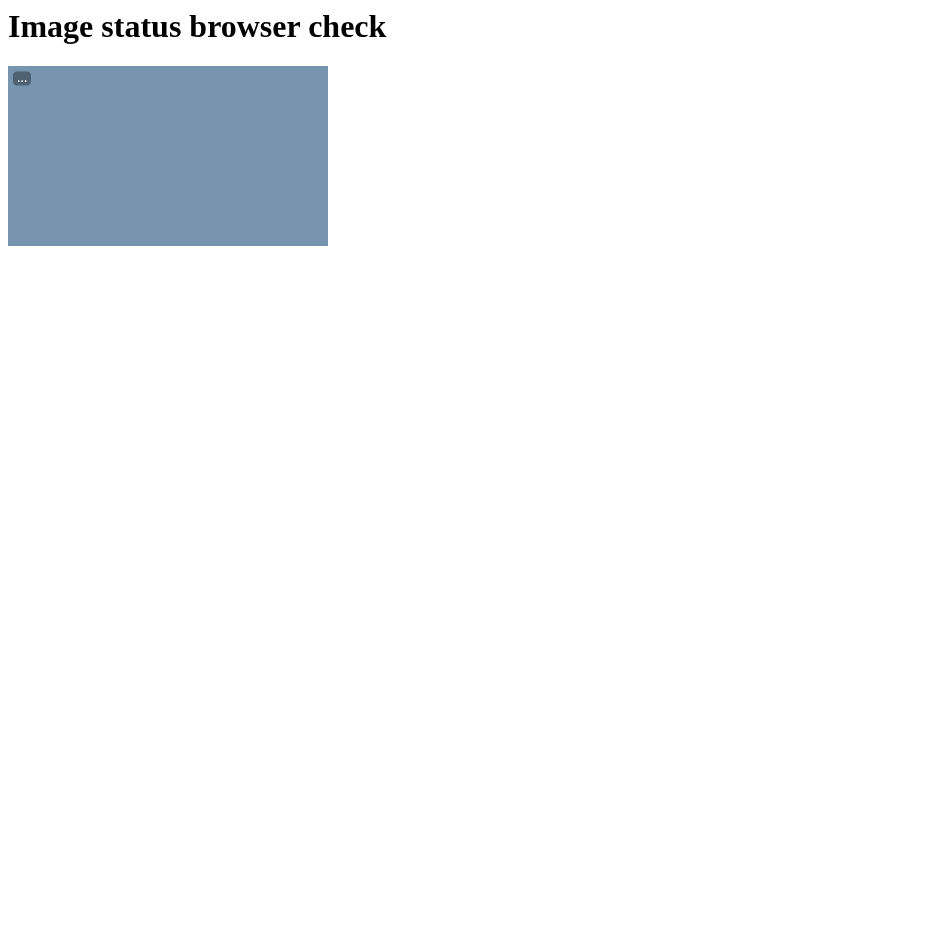
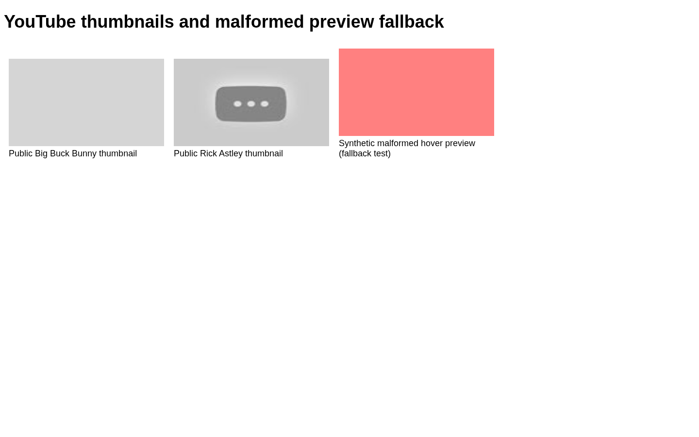
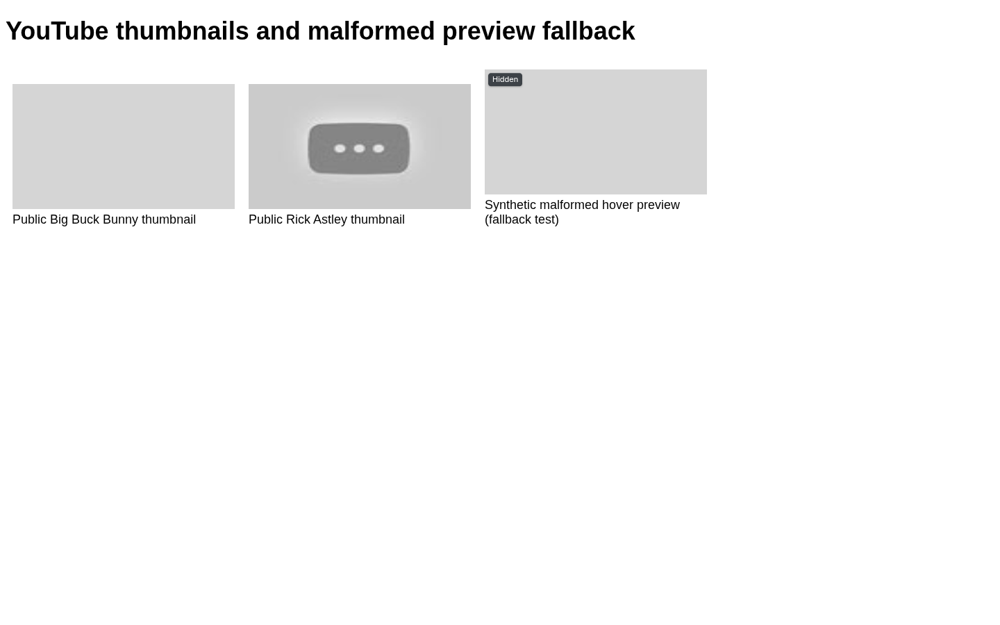
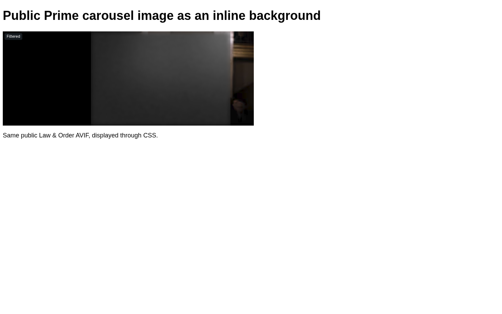
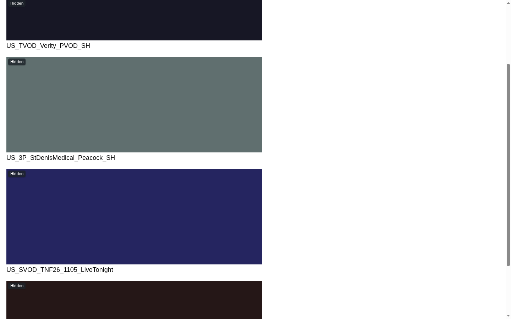

# Media filtering: browser evidence on the test device

Product code in the current media/UI captures: `62b72c6d33fd8d158f21d17284082856421b47a8`.
Baseline: `506ebba40af8`. Commit `84d5760` changes the capture harness only;
the current captures' production-file hashes match `62b72c6` exactly.
Captured 2026-11-05 on an i7-10710U with installed, headed Brave/Chromium 156.
The current public-media and preliminary pipeline captures recorded `quiet` /
`powersave` / energy preference `power`. The later color capture recorded
Performance mode. Each artifact retains its own settings; color correctness is
not used as timing evidence.
Personal browser profiles and account policy were not changed.

## Current browser correctness and appearance

[Public browser observations and provenance](public-browser.json) preserve
source hashes, public asset hashes, verdicts, output pixel checks, page DOM
observations and status API responses. Controlled pages exercise production
image hooks, models, transforms and the status script/API in a separate proxy
and browser profile; authentication and policy are supplied by the fixture.
The candidate uses the AVIF-enabled Pillow 13 wheel selected by its
Containerfile; the baseline uses installed Pillow 12.3 without AVIF support.
These captures demonstrate functional behavior, not a causal performance
comparison or the model's general accuracy.

### Subtle loading, then unobstructed approved images

The current UI shows a small pending indicator and removes the visible badge
when an image is approved or exempt from checking. Filtered or hidden results
retain a label. The separate real-browser status regression passed source
changes, inline backgrounds, unchanged URLs and layout, clicks through badges,
DOM removal cleanup, bounded batches of long CDN URLs and images first shown
after their initial offscreen registration. That regression uses the production
script with fixture image/status responses; the public captures additionally
exercise the production status API.

### Pink fallback

The old emergency PNG decodes to RGBA `(255, 0, 0, 127)`, which looks pink over
white. The replacement is opaque `(214, 214, 214, 255)`. The rightmost tile
below deliberately sends malformed bytes at a YouTube hover-preview address
through the production refusal path. Its 1×1 intrinsic fallback is expected
because the input has no readable dimensions. This proves the fallback fix;
it does not establish how often real previews fail. The public thumbnails to
its left were already hidden upstream or returned HTTP 404, so they provide
no classification evidence.

### AVIF and CSS background: cold timeout, then cached cover

The exact public Law & Order AVIF passed as clean in the baseline. Its OpenCV
reader could decode it while Pillow-dependent refinement was silently skipped.
With native Pillow AVIF support, the current run's first cold `` request
hit the image deadline after 2,025 ms, returned a solid same-size 720×270 tile,
and reported **Not checked · hidden**. It did not produce a cover on that first
request.

The continuing worker cached an **immodest** verdict. A later inline CSS
background request for the identical input SHA-256 returned that cached verdict
and a cover in 129 ms. The screenshot below is this later request and its
**Filtered** label. All seven status requests in `public-media-subtle` returned
HTTP 200, and its three page validations recorded no errors. The three approved
carousel images had no visible settled badge.

### Solid colors and geometry

At policy `all`, four public AVIFs became solid, opaque 720×270 PNGs, retaining
their natural dimensions. In page order their RGB colors are `(16,16,32)`,
`(96,112,112)`, `(32,32,96)` and `(32,16,16)`. These are quantised whole-image
averages with no spatial detail; the saved output files were checked for a
single opaque color and their hashes verified.

This color capture restored old test tabs, which sent **28 stale-token HTTP
403s** to the new proxy. The cumulative log retains them. The captured page
itself made one HTTP 200 status request, decoded all four images, settled all
four states to Hidden and passed its recorded validation. Its final PNG and
DOM are valid color/geometry evidence; this was not a clean performance run.
The harness now creates a fresh temporary profile per run to prevent restored
tabs from contributing traffic.

## Follow-up status reload regression

The later `310b0bd` fix clears a previous image observation when a new network
request starts. A valid image HTTP 304 restores the prior state only within its
TTL and at the same media level; video refusal is unchanged. The page script
restarts pending status for a new load of the same URL and ignores replies from
an earlier image generation. Decision metadata retains the media level used for
that decision, so a subsequent level change cannot relabel it as a new check.

[Focused browser evidence](status-reload-browser.json) records a real same-URL
refetch triggered by changing fetch mode while an older status response is held.
The fixed script ignored that stale checked reply, polled again and reached the
new unavailable state. Removing only the generation guard reproduced the bug.
All UI assertions passed with no page errors, and **57 focused proxy/page tests**
passed with Node enabled. Four screenshot captures timed out and are explicitly
recorded; this regression's evidence is the browser assertions and negative
control, not missing screenshots. These checks use synthetic responses and do
not add performance measurements to the preceding source revision.

## Complete browser comparison with the subtle UI — Performance mode

[All 16 trials and provenance](performance-current.json) compare baseline
`506ebba` with `5468b17`, including the subtle loading indicator and removal of
approved badges. Two pairs per scenario ran in balanced AB/BA order, for 20
seconds each, with fresh proxy/verdict caches. No VM or image build ran during
the comparison. Start and end power settings for every trial were Performance;
all power guards, screenshots and correctness checks passed. These results
remain separate from the earlier low-power run. The subsequent status-cache
reload fix has separate functional checks and is not included in these timings.

Values are medians of the two per-trial metrics on each side. The unrelated
request probe measures `fetch()` to response headers; it does not read the body.
Two pairs are descriptive evidence, not a statistical-significance claim.

| Scenario | Maximum proxy pause, ms | Maximum unrelated request, ms | Page load, ms | Maximum frame gap during load, ms |
|---|---:|---:|---:|---:|
| 36 hidden images | 229.03 → 23.00 | 463.25 → 25.75 | 717.55 → 636.60 | 91.65 → 33.40 |
| 6 images with intrinsic layout | 156.57 → 23.64 | 53.75 → 21.25 | 216.45 → 169.35 | 16.75 → 16.75 |
| 36 covered images | 153.26 → 26.28 | 246.15 → 24.85 | 1190.80 → 1211.30 | 58.40 → 33.40 |
| Image inference + 2 videos | 78.07 → 30.15 | 142.20 → 30.20 | 2863.90 → 2313.35 | 50.05 → 99.95 |

Maximum proxy pauses fell **61–90%**. Hidden-image and inference page loads
fell **11.3%** and **19.2%**; cover-page load increased **1.7%**. Browser timing
still has tradeoffs: inference's maximum loading-frame gap increased from
50.05 to 99.95 ms, and its maximum click-to-next-rAF latency increased from
42.65 to 62.10 ms. Click-to-next-rAF p95 changed by at most 0.2 ms across the
four scenarios. It is not presentation latency or INP; no slow Event Timing
interactions were reported, which does not establish zero latency.

Whole-window unrelated-request p95 was mixed: hidden 13.80 → 16.05 ms,
intrinsic 6.65 → 11.80 ms, covers 17.70 → 12.65 ms, and inference 18.20 →
18.35 ms. Short Performance-mode loads occupy a small fraction of the
20-second sample, so that percentile can omit the initial burst; both p95 and
maximums are retained. The raw ping durations have no timestamps, so a
loading-only ping percentile cannot reliably be reconstructed.

Across all trials, **456/456 image dimensions** and **144/144 expected covers**
were verified. Both clips decoded in every inference trial. The candidate
passed all 36 synthetic images in each inference run; the baseline passed
26 and 28, hiding 10 and 8 after timeouts. Candidate inference pages had 36
checked states and no visible settled badges. This is improved completion under
load, not identical output or a test of model accuracy. All per-trial values,
observed ranges, output counts and source hashes are retained in the JSON.

## Preliminary low-power pipeline measurements — older UI

[Validated paired trials](preliminary-low-power-pairs.json) contain only the
16 completed trials forming two before/after pairs per scenario from
`build/image-perf-browser-verified`. Their candidate is **`fbe3edc`**, which
still showed persistent **Checked** badges. These timings do **not** measure
the final subtle-loading/no-approved-badge UI at `62b72c6`.

Every included trial had recorded `quiet` / `power` / `powersave` mode at its
start, source-file hashes matching the stated commit, valid recorded media and
pixel checks, no browser errors, and natural dimensions independently matched
to the original assets. Raw response counts matched the summaries; all 36
covers were preserved in each cover trial. The unfinished `before-hidden-2`
and unstarted third pairs were excluded. Mode was not sampled continuously.

Values below are the median of each side's two per-trial metrics, shown as
baseline → `fbe3edc`. Percentiles are not pooled across trials. Two pairs provide
preliminary descriptive evidence, not a statistical-significance claim.

| Scenario | Pairs | Ping p95, ms | Proxy loop maximum, ms | Input-to-next-frame p95, ms | Page load, s |
|---|---:|---:|---:|---:|---:|
| 36 hidden images | 2 | 1116.2 → 61.7 | 850.4 → 192.1 | 9.60 → 9.35 | 3.13 → 3.16 |
| 6 images with intrinsic layout | 2 | 36.4 → 28.1 | 802.1 → 189.1 | 6.2 → 6.3 | 1.15 → 0.92 |
| 36 covered images | 2 | 1416.5 → 131.0 | 729.7 → 190.0 | 16.6 → 30.8 | 6.10 → 5.33 |
| Image inference + 2 videos | 2 | 1129.3 → 131.6 | 717.1 → 178.9 | 18.2 → 22.2 | 4.71 → 5.09 |

The proxy stayed more responsive to unrelated requests in these trials, but
browser responsiveness and page-load time did not improve uniformly. Cover
input latency increased, and the inference case loaded more slowly. The
inference case also hid 30/32 images in the baseline versus 26/28 in the
candidate; timeout-driven outputs were not identical. Both sides retained all
36 image dimensions and checked both videos. The JSON includes frame gaps,
load times, output counts and all per-trial results so these tradeoffs remain
visible.

## Historical live-site observations — `86ed2cc`, double-filtered

The `legacy_live_runs` entry in `public-browser.json` retains an earlier
signed-out Amazon, Prime Video and YouTube capture at **`86ed2cc`**. Search-field
typing and Amazon's next-carousel interaction succeeded. Amazon and Prime
served AVIFs through the media path, but the existing host proxy also filtered
these connections and sometimes inserted its older page script. Those runs
are **double-filtered** and cannot establish current candidate UI coverage or
performance. Some pages had large frame gaps. Signed-out YouTube showed no
recommendation thumbnails. These legacy observations are not the current UI
screenshots or the paired measurements above.

## Final local validation and AWS transport

[Local validation and artifact identities](local-validation.json) record the
final product revision `fd9a0cf`, its built image and verified image switch.
CI passed **3,120 device tests** (15 skipped), **24 portal tests**, and 88.33%
coverage. The local `just pr-test` reruns used the exact image, QEMU from devenv,
and disposable child disks:

| Final local check | Actual checks |
|---|---|
| Desktop | 85 passed |
| Inspection | 13 passed, 1 failed, 1 skipped |
| Hardening | 46 passed, 5 skipped |
| Developer | 82 passed |
| Core follow-up | 70/77 harness checks passed; seven Tailscale-dependent failures |

The suite harness additionally counts boot and non-failing skip markers; its
inspection/hardening/developer totals are respectively 15/16, 52/52 and 83/83.
The remaining inspection failure is retained as failed. A separately captured
equivalent public fixture on the final image confirms that an account absent
from guest proxy rules receives an HTTP 404 containing the **outer host's**
filter script. The test expects an untouched origin response. Allowed HTTPS,
blocked URLs, Firefox filtering, Docker Hub pulls, and all 1Password CLI checks
passed in the final reruns.

The earlier full run on `84d5760` remains recorded as failed: desktop 83/85 and
suites 318/338, including seven Tailscale-dependent failures. Its control
registration connection closed on this filtered host. The subsequent core rerun on the final revision reproduced all seven
Tailscale-dependent failures (70/77 harness checks passed). Captured registration
errors report EOF while reading response headers, not certificate verification
failures. The exact cause of the closure remains unresolved; the full VM gate
is not green. These were prepared-disk upgrade tests, not fresh installations;
the artifact corrects the earlier report's misleading master-cache label.

The local adapter imported only the host's public inspection CA into disposable
guests and selected the guest system CA bundle for proxy upstream verification.
A dedicated check changed filtered HTTPS from 502 to 200 while a blocked URL
remained 403, with `ssl_insecure=false`. Host trust and policy were unchanged.
The local QEMU preflight compatibility edit and guest adapter are excluded from
the PR. Test VMs and the isolated browser were shut down after validation.

The subsequently reported new AWS portal error was a proxy HTTP/2
`ConnectionTerminated` / GOAWAY failure. The targeted workaround negotiates
HTTP/1.1 upstream only for `us-east-1.signin.aws`. [TLS transport checks](aws-signin-transport.json)
verified the actual installed mitmproxy/PyOpenSSL ClientHello in both hook
orders: HTTP/1.1 was offered, SNI and peer verification were retained, and other
hosts still offered HTTP/2. Fourteen focused tests passed. An anonymous,
verified HTTP/1.1 request to the public origin returned 302. No private workflow
URL, cookies or login was used. This verifies the transport workaround, not
successful completion of the user's new-portal login.

The final packaged proxy also passed a public-origin GET from a filtered guest
account: HTTP **302**, curl exit 0, TLS verification result 0, and an addon hash
matching `fd9a0cf`. No query, cookies or redirect following was used. That probe
observes the client connection and successful response; upstream ALPN was
verified separately by the ClientHello checks above.

## Reproduction and local raw files

See [the harness instructions](https://github.com/aareman/KosherOS/blob/master/scripts/perf-media/README.md). Full
raw captures are under the main checkout's `build/public-media-before`,
`build/public-media-subtle`, `build/public-media-colors-subtle`,
`build/image-status-browser-subtle`, `build/image-perf-browser-verified`,
`build/image-perf-browser-current-performance` and
historical `build/amazon-browser-after`. This directory contains only small
public evidence artifacts; no personal browsing data or CA private key is
included.

## Inspection test follow-up

Test revision `6247526` replaces the body-branding predicate with TLS signer
checks. A positive control verifies the filtered peer against the guest CA;
the uninspected peer must be readable and must not verify against that CA.
The ordinary verified HTTP request must still complete without a 403. This
checks guest interception directly without mistaking outer-host branding for it.

The revised test ran against the retained `fd9a0cf` runtime image: **17 passed,
0 failed, 1 skipped** (19/19 including harness boot/skip accounting). The earlier
failed run remains in the historical evidence. Tailscale remains unresolved;
the host's own TS2021 diagnostic reproduces EOF independently of the VM.
